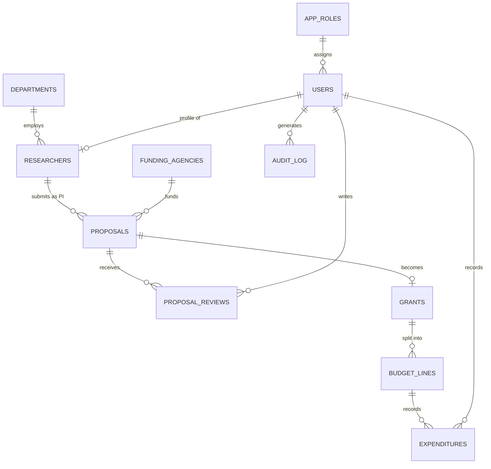

# Phase 1: Database Design and Security Analysis
**System:** University Research Grant Management System (GrantDB)

## 1. System description
GrantDB manages the full life cycle of research funding at a university: researchers submit proposals to funding agencies, an evaluation committee reviews them, the research office awards grants, and the finance office tracks budgets and spending.

## 2. Entity Relationship Diagram
(Renders automatically on GitHub.)

## 3. Major tables

| Table | Purpose | Key security notes |
|---|---|---|
| users | Login accounts, role, lockout counters | Holds `password_hash`; core authentication asset |
| app_roles | The six application roles | Basis for RBAC |
| researchers | Researcher profile | National ID, phone and bank account stored encrypted |
| departments / funding_agencies | Reference data | Low sensitivity |
| proposals | Research proposals and requested funding | Unpublished ideas: intellectual property |
| proposal_reviews | Reviewer scores and comments | Reviewer identity and scores must stay confidential |
| grants | Awarded funding | Integrity of amounts and dates |
| budget_lines | Allocation per category | Integrity |
| expenditures | Spending records | Fraud target; integrity and traceability |
| audit_log | Security event trail | Must be append-only and tamper-resistant |

## 4. Assets, owners, users

| Asset | Data owner | Authorized users |
|---|---|---|
| Credentials (`users`) | IT / DBA | DBA, application account (login only) |
| Researcher personal and banking data | HR / Research Office | GrantsOfficer (limited), FinanceOfficer (bank only), the researcher (own record) |
| Proposals | The PI, Research Office | PI (own), GrantsOfficer, Reviewer (assigned, after submission) |
| Reviews | Evaluation committee | Reviewer (own), GrantsOfficer |
| Grants and budgets | Research Office, Finance Office | GrantsOfficer, FinanceOfficer, PI (own, read-only) |
| Expenditures | Finance Office | FinanceOfficer, Auditor (read), PI (own, read-only) |
| Audit log | Security / Audit | Auditor (read), DBA (administer) |

## 5. Data classification

| Level | Data | Protection planned |
|---|---|---|
| Restricted | password_hash, national_id_enc, bank_account_enc, encryption keys | Hashing/encryption, strictest privileges, access logged |
| Confidential | proposals (abstract), reviews (scores, comments, reviewer identity), expenditures, award amounts, phone_enc | RBAC, row-level restrictions in the application, access logged |
| Internal | grants dates and status, budget lines, researcher names and departments | RBAC |
| Public | department names, agency names | None beyond integrity |

## 6. CIA analysis

| Property | Requirement | Why |
|---|---|---|
| Confidentiality | Reviews anonymous to PIs; proposals hidden from other researchers; banking and ID data encrypted | Prevents idea theft, reviewer pressure, identity and financial fraud |
| Integrity | Only authorized roles change amounts, scores, status; spending cannot exceed allocation; audit log immutable | Prevents fraudulent funding, score tampering, cover-up |
| Availability | Backups, tested recovery, protection from deletion of grants/expenditures | Funding deadlines and financial reporting depend on the data |

## 7. Threat model (STRIDE)

| Threat actor | Example threat | Category | Attack surface | Planned control |
|---|---|---|---|---|
| External attacker | SQL injection on login or search | Tampering, Information disclosure | Web forms, DB queries | Prepared statements, validation |
| External attacker | Credential stuffing, brute force | Spoofing | Login page | Hashing, lockout, logging |
| Malicious researcher (PI) | Edits own proposal score or reads other proposals | Tampering, Information disclosure | Application and DB privileges | RBAC, least privilege |
| Malicious reviewer | Leaks proposal content or inflates a friend's score | Information disclosure, Tampering | Review module | Assignment checks, audit |
| Insider finance officer | Inserts fake expenditures, diverts funds via bank data | Tampering, Repudiation | Expenditures, researchers | Constraints, audit log, separation of duties |
| Privileged insider / DBA | Unusual queries on sensitive tables, log deletion | Elevation of privilege, Repudiation | DB admin accounts | Audit, restricted log privileges |
| Stolen backup or disk | Reads database files | Information disclosure | Backups, data files | Encryption at rest, backup protection |
| Network eavesdropper | Sniffs DB or web traffic | Information disclosure | Network | TLS |
| Accident / ransomware | Table dropped, data lost | Denial of service | Database | Backup and tested recovery |

## 8. Main attack surfaces
Web login and forms, database connection from the application, DBA and service accounts, backup files, configuration files (credentials), database network port, audit log table.
